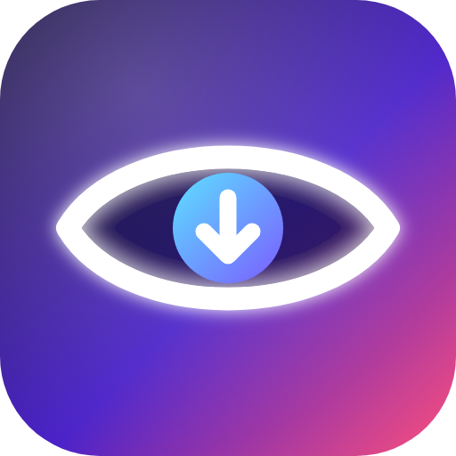
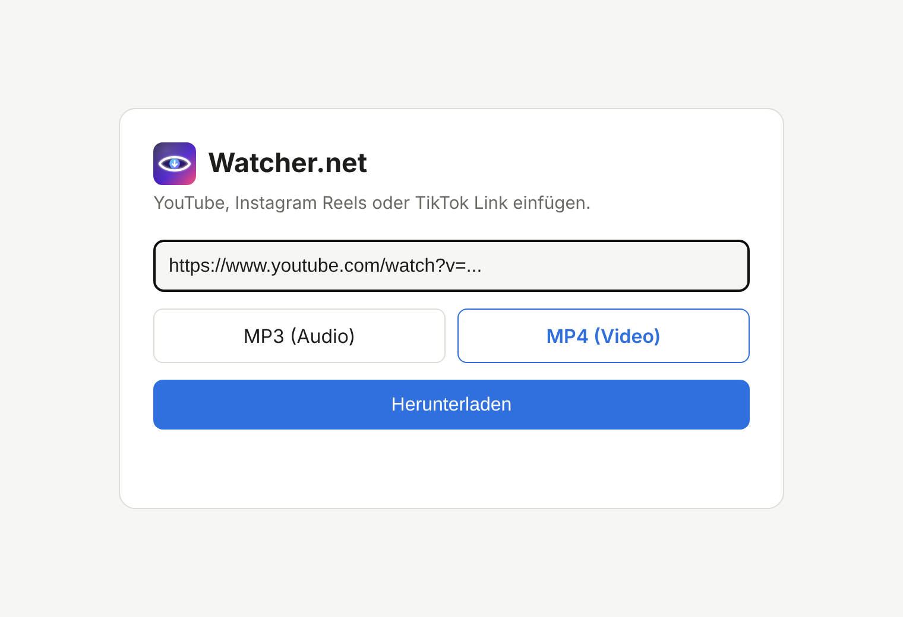

# Watcher.net



Link von **YouTube**, **Instagram Reels** oder **TikTok** einfügen, auf *Herunterladen* klicken, fertig. Du bekommst die Datei als **MP3** (nur Ton) oder **MP4** (Video) in der besten verfügbaren Qualität.



## So geht's (Windows)

1. **[Watcher.exe herunterladen](https://github.com/Beerus-Bennet/watcher.net/releases/latest/download/Watcher.exe)**
2. **Doppelklick** auf `Watcher.exe`. Dein Browser öffnet sich mit der Seite oben.
3. **Link einfügen**, MP3 oder MP4 wählen, auf **Herunterladen** klicken.

Die fertigen Dateien liegen im Ordner **Downloads › Watcher.net**.

Du musst sonst nichts installieren. Zum Beenden das schwarze Fenster schließen, das beim Start mit aufgeht.

**Windows-Warnung beim ersten Start?** Wenn „Der Computer wurde durch Windows geschützt“ erscheint: auf **Weitere Informationen** und dann auf **Trotzdem ausführen** klicken. Das kommt, weil die App neu und nicht kostenpflichtig signiert ist.

**Funktioniert ein Link nicht mehr?** YouTube und Co. ändern sich oft. Einfach die neueste `Watcher.exe` über den Link oben herunterladen. Sie wird jede Woche automatisch neu gebaut.

> Nur für den privaten Gebrauch und nur für Inhalte, an denen du die Rechte hast oder deren Download erlaubt ist. Kopiergeschützte Dienste wie Netflix, Disney+ oder Spotify werden bewusst nicht unterstützt.

---

## Für Fortgeschrittene

<details>
<summary>Auf dem Handy nutzen</summary>

Watcher.net läuft auf deinem Computer, das Handy kann es im selben WLAN mitbenutzen.

1. Watcher mit dem Zusatz `--handy` starten (z. B. Verknüpfung zu `Watcher.exe` anlegen und im Feld *Ziel* hinten ` --handy` ergänzen).
2. Im schwarzen Fenster steht eine Adresse wie `http://192.168.0.23:5000`. Diese auf dem Handy öffnen.
3. **iPhone:** Teilen › „Zum Home-Bildschirm“. **Android:** Menü (⋮) › „Zum Startbildschirm hinzufügen“.

Watcher.net erscheint dann mit eigenem Icon wie eine App. Der Computer muss dafür laufen. Mit `--handy` ist die Seite für alle Geräte im WLAN erreichbar, also nur im eigenen Heimnetz verwenden.
</details>

<details>
<summary>Mac / Linux oder aus dem Quellcode starten</summary>

Voraussetzungen: [Python 3.10+](https://www.python.org/downloads/) und ffmpeg (`brew install ffmpeg` bzw. `sudo apt install ffmpeg`).

```bash
./start.sh            # Mac/Linux
start.bat             # Windows ohne die fertige App
python cli.py "https://www.youtube.com/watch?v=..." mp3   # ohne Oberfläche
```
</details>

<details>
<summary>Was „beste Qualität“ heißt</summary>

- **MP4:** bestes Video plus beste Tonspur, zusammengefügt. Das Bild wird nicht neu kodiert. Der Ton wird in AAC umgewandelt, damit die Datei auf jedem Gerät abspielt.
- **MP3:** beste Tonspur, umgewandelt in MP3 mit höchster Qualitätsstufe (VBR V0), mit Titel und Vorschaubild.
</details>

<details>
<summary>Technik, Icons, Lizenz</summary>

- Basiert auf [yt-dlp](https://github.com/yt-dlp/yt-dlp) und [ffmpeg](https://ffmpeg.org). Die Windows-App bringt ffmpeg (GPL, Build von [BtbN](https://github.com/BtbN/FFmpeg-Builds)) als eigenständiges Programm mit.
- Die Windows-App wird von GitHub Actions gebaut (`.github/workflows/windows-app.yml`): bei jeder Änderung und jeden Montag.
- Icons in allen Größen liegen in `static/icons/` (Quelle `icon.svg`): Favicon 16–48, iPhone 180, Android 192/512 inkl. „maskable“, Windows-Icon in `packaging/watcher.ico`.
- Lizenz: MIT, siehe [LICENSE](LICENSE).
</details>
